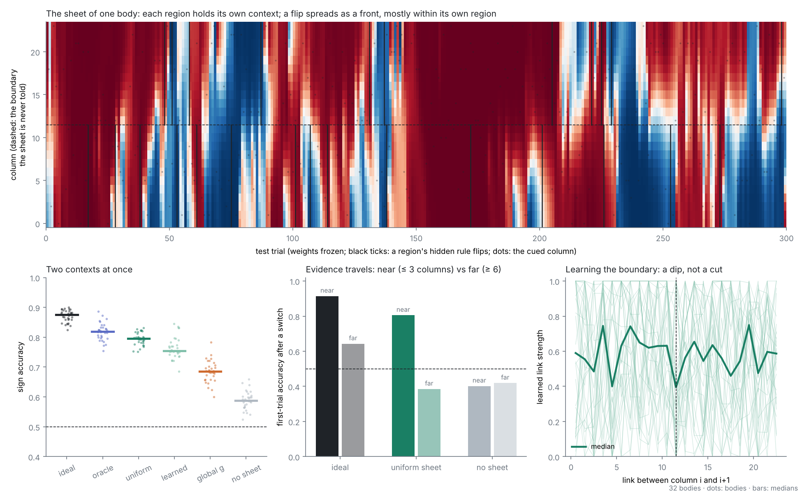

# TuftSheet

**Many local machines under one shared sheet, instead of one global machine.** A row of relational columns, each relating its local input to the state of a Layer-1 sheet just above it. The sheet holds two independent hidden contexts at once, one in each half of the row, where a single global context state cannot. A surprise spreads sideways as a front, nearer columns get it first, and the boundary between contexts mostly holds. Five of six rules set before the run held, all at 32/32 where counted. The sixth, learning *where* the boundary is, failed.

Antti Luode's idea (on a bike, after a talk with Gemini about apical tufts) · Claude Opus 5.5, design, code and write-up · 17 November 2026.

[Protocol, committed before the batch](PROTOCOL.md) · [the sheet](sheet/sheet.py) · [world, ideal observer, variants](experiments/world.py) · [receipt](experiments/results.json) · [summary](experiments/summary.json)



## The idea

In [ApicalRuleReversalMachine](https://github.com/anttiluode/ApicalRuleReversalMachine) and [WaveCortex](https://github.com/anttiluode/WaveCortex), every apical tuft read the **same** context state *g*. That works when the world has one hidden rule. A real world has many things going on in different places.

Antti's picture: a pyramidal neuron's tuft reaches up into Layer 1, a sheet that is almost all horizontal axons. It asks: *given the state of the world here, what does my local input mean?* Each column is a small machine. The context moves **horizontally** at the top, and the world model is not stored anywhere: it is the pattern the whole sheet agrees on.

## The machine

**Columns.** 24 relational neurons in a row, in the scalar form of WaveCortex (the scalar copy was the more accurate one there):

```math
\text{prediction}_i = A\,(W_i + g_i V_i), \qquad g_i = \tanh(\phi_i)
```

- **content forward:** A·W, the basal part, whatever the context;
- **context from the tuft:** g_i·V, read from the sheet directly above column *i*;
- **residue up:** after a trial, the column's surprise is pushed into the sheet at its own place, with ApicalRuleReversalMachine's normalized step.

**The sheet.** A field φ of log-odds of the rule along the row. Pushes add evidence. Between trials it **spreads sideways** along its links and **leaks** slowly toward zero, which is how old evidence fades when rules can change.

**What the sheet is, plainly.** It is a diffusive field, a sheet with neighbour links. It is not WaveComputer's linear wave field. A wave passes on; a context has to stay. So this tests whether a *field* earns its place, not whether *waves* do.

**Variants**, all trained on the same sequences:

| | Context state |
|---|---|
| `uniform` | the sheet with every link equal |
| `learned` | links learned from whether neighbours' recent pings agree in sign; nothing says where the boundary is |
| `oracle` | the link at the true boundary cut: the best a sheet could do |
| `global` | one *g* for every column: ApicalRuleReversalMachine's machine |
| `local` | no sheet links: every column alone |
| `ideal` | the exact observer: knows the regions, the noise and the flip rate |

## The world

- 24 columns. Columns 0–11 are the left region, 12–23 the right.
- Each region has its own hidden rule ±1, which flips by itself with probability 1/30 per trial, independently of the other region.
- Each trial cues one random column with A = ±1. The outcome is B = rule(region)·A, wrong 10% of the time.
- Training: 4000 trials. Test: 600 fresh trials, with weights and links frozen; the sheet keeps running.

## Results

32 bodies, seeds 600001–600032. Medians.

| Rule set beforehand | Required | Measured | |
|---|---|---|---|
| **T1** two contexts at once | sheet ≥ 0.75; beats global and no-sheet in ≥ 29/32 | **0.80** (ideal 0.88; global g 0.69; no sheet 0.59); **32/32** and **32/32** | pass |
| **T2** sideways transfer: first trial after a switch, within 3 columns of an already-surprised one | sheet ≥ 0.70, no-sheet ≤ 0.50 | **0.81** (ideal 0.91); no sheet **0.40** | pass |
| **T3** the boundary holds: the other region, just after a switch | ≥ 0.85; above global in ≥ 24/32 | **0.94** (ideal 0.97; global g 0.73); **32/32** | pass |
| **T4** evidence travels: accuracy drop from near to far, beyond the ideal's | > 0.05 | sheet drops **0.42**, ideal **0.24**; extra **0.16** | pass |
| **T5** cut the tufts: the sheet's context removed | at chance | **0.50** | pass |
| **T6** the boundary is learned: the learned boundary link is below the typical link | ≥ 24/32 | **22/32**; the weakest link in only **3/32** | **fail** |

Also measured:

| | sign accuracy | squared error to ideal |
|---|---:|---:|
| ideal | 0.88 | 0 |
| oracle sheet (boundary given) | 0.82 | 0.129 |
| **uniform sheet** | **0.80** | **0.154** |
| learned links | 0.76 | 0.207 |
| one global g | 0.69 | 0.286 |
| no sheet | 0.59 | 0.373 |

- The oracle beats uniform in 29/32 bodies, but only by 0.02.
- Learned links lose to uniform links in 29/32.

## What it shows

1. **One context state can't hold two worlds; a sheet can.** The global *g* of the earlier machines is right only in whichever region last surprised it (0.69). The sheet holds each region's context in place (0.80, 32/32 bodies). In the heatmap you can see the two halves wear different colours whenever their rules differ.
2. **The sheet does not need to know where the boundary is.** Evidence keeps arriving on both sides, so the field settles into two domains with a soft wall between them. Cutting the link at the true boundary helps only a little (0.82 against 0.80), and a switch on one side barely reaches the other (0.94).
3. **Changing its mind takes time and travels.** A column next to an already-surprised one gets the new context 81% of the time; a far one 39%. The ideal observer, which has no space, falls off less. In the heatmap, flips appear as slanted fronts, not vertical lines. That is the property travelling-wave findings in cortex point to: perceptual switches in binocular rivalry have been seen to sweep across the visual field.
4. **Neighbours cannot yet find the boundary by themselves.** The learned links dip at the boundary in most bodies (median link 0.40 there), but they also dip elsewhere. They never cut cleanly, and they cost accuracy. A rule that listens only to rare pings, one column per trial, is too noisy. This is the open problem.

## Ledger

**Shown:** T1–T5, pre-registered, at 32/32 where counted. **Failed:** T6, the learned boundary (22/32, needed 24); I called it a coin toss beforehand.

**Development, disclosed in the protocol:**
- the first world used fixed-length blocks; its two rules stayed anti-correlated for long stretches, and one global *g* exploited that, so it was replaced with independent flips;
- slow spread let columns learn opposite sign conventions, so spread was made faster;
- the push strength and the link-learning rates were chosen on six development bodies.

**Supplied, not learned:** column positions and order (which columns are neighbours), the spread and leak rates, the push strength, and the starting context.

**Not shown:**
- that *waves* help: the sheet is diffusive by design;
- a learned boundary;
- 2D sheets, more than two contexts, or contexts that move;
- that the sheet could be read by something downstream.

**Known:**
- consensus and diffusion on graphs;
- belief propagation;
- many column models voting through lateral links, as in Hawkins' thousand brains;
- travelling waves in cortex (Muller et al.; Wilson, Blake & Lee on rivalry).

**Ours:**
- the relational column (content forward, residue up, context multiplied in from a sheet above it), under local rules, against one global *g*, no sheet, an oracle, and the exact ideal;
- the travel and boundary measurements.

## Where it goes next

- **Learn the boundary from the field, not from pings.** A link could weaken when its two columns are *persistently* surprised in opposite directions while the sheet between them agrees. That is a Martinotti-like precision rule.
- **Two dimensions and moving contexts.** A context that drifts across the sheet, like the occluded ball, is where a sheet should leave a fixed global state far behind.
- **A second-order (wave) sheet beside the diffusive one,** so that "do waves earn their place" gets tested directly, with a scalar copy beside it.

## Run

```sh
python -m pip install numpy matplotlib
python experiments/dev.py        # development bodies (10 s)
python experiments/run.py        # the batch, 32 bodies (1 minute on two cores)
python experiments/analyze.py    # summary.json against PROTOCOL.md
python experiments/figure.py
```

## Lineage

- [ApicalRuleReversalMachine](https://github.com/anttiluode/ApicalRuleReversalMachine): the gate and the normalized surprise step.
- [WaveCortex](https://github.com/anttiluode/WaveCortex): the relational column, and the finding that its scalar form is the more accurate one.
- [SyntheticQualia](https://github.com/anttiluode/SyntheticQualia): the paper. This repo is a step toward its Section 8 and toward Sol's point that the world is "the coordinated readiness of the population".
- [WaveComputer](https://github.com/anttiluode/WaveComputer).

MIT licence.
